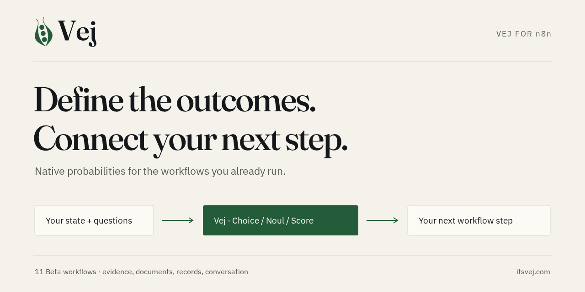
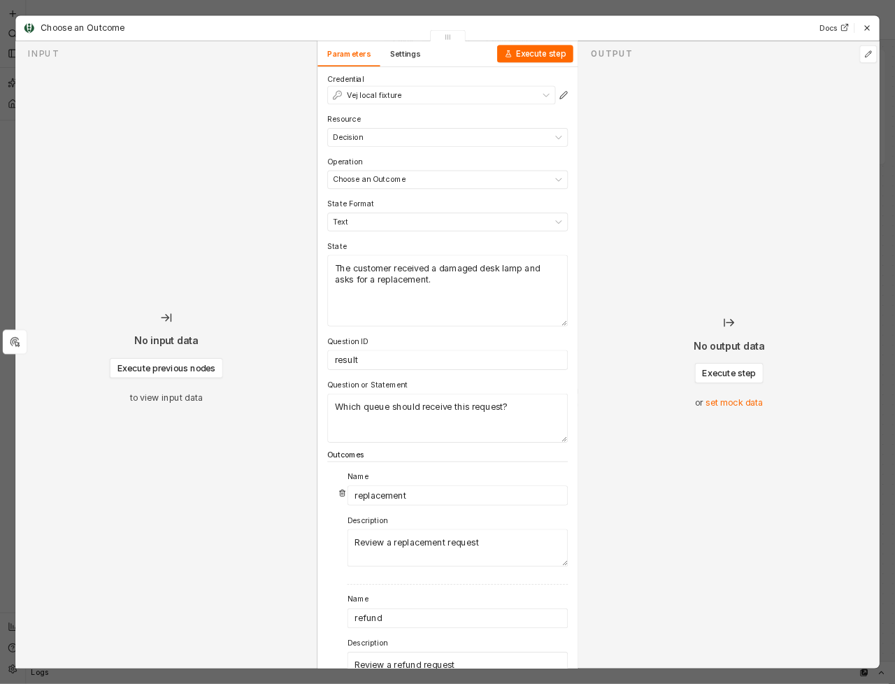

<picture>
  <source media="(prefers-color-scheme: dark)" srcset="assets/logo-light.svg">
  
</picture>

# State in, probabilities out. In n8n.

[](https://github.com/LodeKennes/vej-n8n-node/actions/workflows/check.yml)
[](LICENSE)
[](https://bun.sh)

Route a request. Check a document. Match a record. Keep the probabilities.

**`n8n-nodes-vej` brings Vej's native decisions and all 11 published Beta workflows into n8n.** Define the outcomes and questions; Vej returns numerical probabilities. Connect the results to your existing Switch, IF, review, and storage steps.



[Install](docs/installation.md) · [Import an example](examples/README.md) · [Operations and use cases](docs/operations.md) · [Vej](https://itsvej.com/) · [Get API access](https://app.itsvej.com/)

## What you can build

- **A decision step:** Choice selects among named outcomes; Noul assesses a statement; Score assesses rubric levels. Send several independent questions in one native request.
- **A document review:** identify source evidence, label document segments, and estimate quantities over your own value bins.
- **A workflow with context:** evaluate conversation history, ask conditional questions, match supplied records, and resume checks when someone supplies missing information.
- **A review queue:** apply a fitted risk threshold, use reviewed corrections for recalibration, or inspect ranking probabilities.

The package has **33 actions across eight resources**, light and dark Vej icons, credential testing, per-item expressions, and paired outputs. **Build requests with forms:** add outcomes, questions, rubric levels, sources, records, segments, checks, and reviewed labels using repeatable rows. Every API response keeps its probabilities, statuses, metadata, and usage.

Advanced JSON is optional for bulk data and full native payloads. Existing version 1 nodes retain their saved JSON behavior; newly added nodes use the version 2 form builder.

## All 11 use cases

| Vej use case | Resource → operation |
| --- | --- |
| Target error rate | Workflow → Target Error Rate; Calibration → Fit a Calibration |
| Show the evidence | Workflow → Show the Evidence |
| Number with a range | Workflow → Estimate a Number with a Range |
| Label every part of a document | Workflow → Label a Document |
| Watch a conversation | Conversation → Create / Append / Query / Get / Delete |
| Use your corrections | Feedback → Use Your Corrections / Delete Retained Feedback |
| If so, then… | Workflow → Ask a Conditional Question |
| Pick the correct record | Workflow → Pick the Correct Record |
| Step-by-step checks | Workflow → Run Step-by-Step Checks |
| Rank with probabilities | Workflow → Rank with Probabilities |
| Select effort | Workflow → Select Effort |

Also includes retained and transient calibration lifecycle actions, explicit retention consent, batch submission/status/cancellation, model availability, account information, and usage.

## Install from source

Requires Bun and a **self-hosted n8n** instance. The package is developed, built, and tested with Bun; its compiled CommonJS runs inside n8n's supported runtime. Tested with n8n **2.43.8**.

```bash
git clone https://github.com/LodeKennes/vej-n8n-node.git
cd vej-n8n-node
bun install --frozen-lockfile
bun run build
mkdir -p ~/.n8n/custom
cp -R dist/nodes dist/credentials ~/.n8n/custom/
```

Run the copy as the account that owns the n8n data directory, then restart your n8n instance. For Docker, mount those compiled folders into `/home/node/.n8n/custom`. The [installation guide](docs/installation.md) also covers the release tarball, Docker, credentials, and n8n Cloud.

## Your first decision

1. Add **Vej** to a workflow and create **Vej API** credentials. The hosted service root is `https://api.itsvej.com`; enter your `vej_sk_…` key.
2. Select **Decision → Choose an Outcome**. Map an incoming message into **State**, enter your question, and edit the outcome names/descriptions.
3. Run the node. With the default question ID, branch on `{{ $json.answers.result.choice }}` and inspect `{{ $json.answers.result.probabilities }}`.

For Beta actions, leave **Input Method → Form** selected. Use **Add Source**, **Add Record**, **Add Question**, and the other row controls to assemble the request. The node adds the correct API envelope and route. **Predict Multiple Questions** has separate Choice, Noul, and Score question groups; each question keeps its own ID and outcomes.

Expressions work on individual form fields, including conversation IDs and sequences. For bulk data, change **Input Method → Advanced JSON** and map an object from an earlier node. You can also map repeated collections using n8n expressions; see [operations](docs/operations.md).



## Availability and interpretation

Choice, Noul, and Score use `/v1/predict`. The 11 extended workflows use `/v1beta` and require access and deployment support. This integration does not change API availability or establish model quality.

- **Effort:** standard executes; fast and careful are deferred. HTTP 200 can contain unavailable results. Inspect each question's status.
- **Rankings:** Beta quality gate failed; deployments without a qualified sidecar return `ranking_unavailable`.
- **Risk and feedback:** the sample form rows illustrate the shape. Replace placeholder digests, tokens, and labels with your own data. Risk fitting requires separate cohorts and at least 500 independent risk-fit groups. Normalized probabilities and a fit do not establish a population error guarantee.
- **Conversation state:** organization retention consent is explicit. The node never enables it automatically. Append and query advance the sequence; no automatic retries are performed.
- **Batch:** hosted execution is not currently open because approved EU storage hosts are not configured. The actions support deployments that enable them.
- **Inputs:** the hosted Pea service is text-only. An image-capable native request can be passed through only to a separately enabled experimental deployment; it does not imply measured vision quality.

Your workflow owns downstream actions. Evidence offsets count Unicode code points, and Score expectations use zero-based level indices. n8n may retain execution inputs and outputs according to its own settings, independently of Vej's retention policy.

[Read Vej's current use-case status](https://itsvej.com/use-cases/).

## n8n Cloud

The full Vej node needs **npm publication with provenance and n8n verification** before Cloud can install it. A manual publishing workflow and [Cloud installation/submission guide](docs/n8n-cloud.md) are included; npm publication and n8n approval remain pending.

For Cloud today, import [the built-in-node Choice example](examples/cloud-choice.json). Edit the ordinary fields and select a Header Auth credential; its HTTP request is preconfigured and needs no hand-written JSON.

## Development

```bash
bun install --frozen-lockfile
bun run check
bun run dev
```

`bun run check` runs TypeScript checks, the official strict n8n linter, Bun contract/execution tests, the official n8n build, and package checks. There are no shipped runtime dependencies. Tests use authored fixtures and pinned Vej request schemas; they do not call paid inference or measure model quality.

[Validation](docs/validation.md) · [Contributing](CONTRIBUTING.md) · [MIT code license](LICENSE) · [Asset and schema notices](NOTICE)
